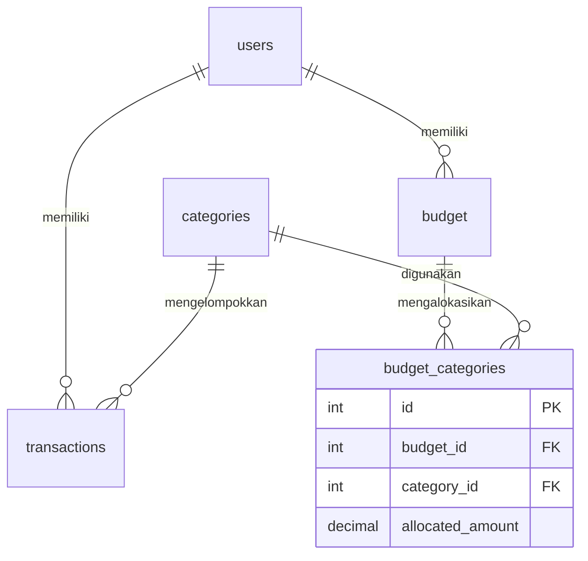

# Rancangan Asisten Keuangan

> **Status dokumen:** diselaraskan dengan implementasi proyek versi 30 endpoint pada `README.md`, router Express, model Sequelize, dan skema SQL aktif `sql/Gabungan.sql`. Dokumen ini membedakan perilaku yang sudah diimplementasikan dari rancangan keamanan yang belum aktif.

## Domain dan masalah

Service REST Asisten Keuangan mengelola pengguna, kategori, transaksi pengeluaran, dan alokasi Budget bulanan. Implementasi aktif terdiri dari 30 kombinasi method + path bisnis di bawah `/api/v1`; endpoint informasi server `GET /` tidak dihitung. Pengguna dibantu melihat pengeluaran per kategori/user serta membandingkan pengeluaran dengan alokasi. Category digunakan bersama; Budget dimiliki satu User dan dapat memakai banyak Category melalui pivot berisi allocated_amount.

Dua consumer: aplikasi web pribadi untuk mencatat pengeluaran dan memantau sisa Budget; aplikasi mobile untuk memasukkan transaksi harian serta melihat perkiraan nilai dalam mata uang lain. Keduanya memanggil kontrak REST yang sama.

Service menyimpan data dan relasi lokal, memvalidasi referensi/periode, menerapkan aturan bisnis, dan menghitung ringkasan Budget. API kurs hanya menyediakan kurs, sehingga tidak dapat menggantikan pencatatan pengeluaran, relasi pengguna, dan alokasi anggaran milik aplikasi.

## ERD

Constraint `UNIQUE(user_id, month, year)` membatasi satu Budget per pengguna dan periode; `UNIQUE(budget_id, category_id)` mencegah kategori ganda pada pivot. Lima tabel aktif (`users`, `categories`, `transactions`, `budget`, `budget_categories`) masing-masing memiliki model Sequelize yang didaftarkan di `src/models/index.js`. Model `User` memakai `paranoid: true` dan default scope yang mengecualikan password. Model `Category` menormalkan spasi nama melalui setter dan menyediakan virtual `formatted_name`; `User` dan `Budget` juga memiliki virtual untuk informasi tampilan. Validasi request utama dilakukan melalui skema Joi; validasi model/database menjadi lapisan tambahan.

## Aturan bisnis

1. Kategori yang masih dipakai Transactions atau alokasi Budget tidak boleh dihapus: 409, melalui pengecekan transaksi dan FK RESTRICT.
2. Budget user/bulan/tahun yang sudah ada tidak boleh dibuat lagi atau ditimpa lewat perpindahan periode: 409.
3. Alokasi Budget harus bernilai positif dan maksimal dua angka desimal sesuai validasi endpoint: 400.
4. Kategori tidak boleh berulang dalam satu Budget: 400.
5. Email User yang sudah terdaftar tidak boleh digunakan lagi: 409. Soft-deleted User tetap mempertahankan batas unik email.
6. PUT wajib lengkap, PATCH tidak boleh kosong, dan field asing ditolak: 400.

## Arsitektur dan validasi

`src/routes/` memasang method/path dan middleware; alur request serta aturan bisnis berada di `src/controllers/`; definisi tabel dan relasi berada di `src/models/`. `index.js` memasang router di prefix `/api/v1`, middleware logger, penanganan 404, dan error handler. Input POST/PUT/PATCH divalidasi menggunakan Joi dengan `abortEarly: false`; respons validasi memuat rincian field/pesan dalam bahasa Indonesia. Password baru di-hash menggunakan scrypt dan tidak dikirim kembali pada respons. Penanganan async memakai wrapper agar error diteruskan ke error handler terpusat.

Create memakai `201 Created` dan header `Location` jika ditentukan kontrak endpoint; penghapusan kategori/Budget memakai `204 No Content` jika berhasil. Data tidak ditemukan menghasilkan `404`; method yang tidak didukung pada resource yang dikenal menghasilkan `405` dengan header `Allow`; konflik aturan bisnis menghasilkan `409`; input tidak valid menghasilkan `400`. Error internal tidak boleh membocorkan SQL, stack trace, atau kredensial. Kegagalan dependensi database/provider ditangani dengan status yang sesuai, termasuk `503` untuk layanan atau konfigurasi yang tidak tersedia.

## ORM dan raw query

GET /api/v1/transactions default memakai ORM (mode=orm): findAll/include dengan Op.like, Op.gte, Op.lte, sort, limit, offset. ORM dipakai sebagai jalur utama untuk menjaga konsistensi relasi/model. mode=raw menyediakan versi pembanding melalui sequelize.query dengan replacements. Nilai filter/pagination memakai parameter. Arah sort hanya menerima asc/desc; keyword ini dipilih dari daftar terbatas, bukan nilai bebas.

Kedua versi mengembalikan kontrak yang sama. Raw memberi kendali SQL namun membutuhkan pemeliharaan JOIN/soft delete secara eksplisit. Ini dua implementasi operasi baca, bukan dua kali penulisan transaksi.

GET daftar/detail Budget memakai Sequelize `include` untuk Category dan `through.attributes` untuk `allocated_amount`. Alias kategori pada JSON adalah `categories`; data pivot berada pada tabel/model `budget_categories`/`Budget_categories`. GET daftar Budget dirancang menggunakan satu SELECT JOIN. Summary Budget memakai dua SELECT tetap (Budget beserta relasi dan agregasi transaksi), bukan query per kategori. Perhitungan summary menggunakan transaksi milik user pada bulan/tahun `transactions.createdAt` dan hanya menghitung kategori yang dialokasikan pada Budget tersebut; seluruh nominal transaksi diperlakukan sebagai pengeluaran karena model belum memiliki jenis transaksi pemasukan.

## Keamanan dan akses — status implementasi

**Penting:** autentikasi JWT/role-based access control belum diterapkan. Endpoint aktual saat ini tidak memaksakan login dan belum menegakkan matriks kepemilikan pada tabel di bawah. Karena itu, matriks ini adalah target rancangan, bukan jaminan keamanan runtime.

| Resource/path | Admin | Pengguna terautentikasi | Tamu |
|---|---|---|---|
| /users | GET semua, POST | Tidak | POST registrasi saja |
| /users/:id | GET/PUT/PATCH/DELETE semua | Akun sendiri | Tidak |
| /users/:id/transactions | GET semua | Data sendiri | Tidak |
| /users/:id/budgets | GET semua | Data sendiri | Tidak |
| /users/:id/subscription-status | GET semua | Data sendiri | Tidak |
| /categories dan /categories/:id | Semua method terdaftar | GET | Tidak |
| /categories/:id/transactions | GET semua | GET transaksi sendiri | Tidak |
| /transactions dan /transactions/:id | Semua method terdaftar | CRUD transaksi sendiri | Tidak |
| /transactions/:id/conversion | GET semua | GET transaksi sendiri | Tidak |
| /budgets dan /budgets/:id | Semua method terdaftar | CRUD Budget sendiri | Tidak |
| /budgets/:id/summary | GET semua | GET Budget sendiri | Tidak |

Pada implementasi keamanan berikutnya, admin akan mengelola kategori dan operasi administratif. Pengguna harus dibatasi pada data miliknya sendiri; identitas pemilik wajib berasal dari token/sesi terverifikasi, bukan dari `id_user` atau `user_id` yang dikirim client. Tamu hanya boleh melakukan registrasi. Sampai middleware autentikasi dan otorisasi dibuat serta diuji, jangan mempublikasikan API ini untuk data keuangan nyata.

Konfigurasi lokal dibaca dari `.env`; gunakan `.env.example` sebagai template dan isi kredensial sendiri. Jangan commit `.env` atau membagikan API key. Untuk deployment, gunakan secret manager/environment secrets, pisahkan development dan production, batasi hak akses akun database, rotasi key, serta jangan mencetak rahasia ke log. Dokumen ini tidak menyatakan bahwa riwayat seluruh commit telah diaudit.

## Integrasi API

Endpoint /transactions/:id/conversion menggabungkan transaksi dari DB dan kurs dari ExchangeRate-API melalui Axios. Field provider dipilih dan diganti nama menjadi base_currency, target_currency, rate, updated_at; estimated_amount merupakan estimasi tampilan. Key berada pada EXCHANGE_RATE_API_KEY.

Endpoint /users/:id/subscription-status menggabungkan profil DB dengan status Midtrans dari order yang dikonfigurasi untuk user tersebut pada MIDTRANS_ORDER_IDS. Tidak ada order global tetap atau key dummy. Pemetaan environment adalah batasan prototipe, bukan desain penyimpanan order produksi.

Timeout menghasilkan 504; network/non-2xx atau payload invalid 502; konfigurasi provider/order belum tersedia 503. Tidak ada fallback kurs atau status pembayaran palsu. Axios menggunakan timeout, AbortSignal, batas ukuran respons, dan tanpa redirect.

## Pengujian dan batas verifikasi

Status yang dicatat dalam dokumentasi proyek: 17 tes otomatis dan koleksi Postman/Newman berisi 52 request serta 128 assertion lulus menggunakan database simulasi. Cakupan mencakup validasi, error API, method tidak didukung, endpoint baru, dan ringkasan Budget. Pengujian default untuk integrasi provider memverifikasi respons `503` ketika konfigurasi belum tersedia; jalur sukses provider pada tes kode menggunakan adapter simulasi. **Ini bukan bukti bahwa seluruh alur telah berhasil dengan MySQL maupun API provider asli.** Jalankan ulang `npm test` dan Postman Runner pada salinan terbaru sebelum menyatakan hasil pengujian terkini.

## Bukti SQL aktual

Jalankan `node scripts/bukti-budget-join.js` pada MySQL aktif yang memiliki Budget dan kategori terkait. Skrip merekam SQL yang benar-benar dijalankan pada bagian bukti otomatis di dokumen. Jika bagian bukti tersebut belum terisi, bukti SQL aktual belum direkam; log tes simulasi tidak dapat menggantikannya. Gunakan database pengujian dan pastikan konfigurasi `.env` menunjuk ke database yang benar.

## Ringkasan kontrak endpoint

Jumlah endpoint bisnis dihitung berdasarkan kombinasi HTTP method + path, bukan jumlah request Postman. Query string seperti `mode=orm`/`mode=raw` tidak menambah jumlah endpoint. `GET /` hanya metadata server.

| Modul | Jumlah | Cakupan utama |
|---|---:|---|
| Users | 9 | CRUD user, transaksi per user, Budget per user, status langganan |
| Categories | 6 | CRUD kategori dan transaksi per kategori |
| Transactions | 8 | Daftar, create, detail, replace/update/delete, konversi mata uang |
| Budgets | 7 | Daftar, create, detail, update, delete, summary |
| **Total** | **30** | Endpoint bisnis pada `/api/v1` |

## Daftar endpoint

| No | Method | Path | Fungsi | Sukses | Gagal |
|---|---|---|---|---|---|
| 1 | GET | `/api/v1/users` | Daftar user aktif; pencarian, sort, pagination | 200 | 400, 404, 405, 503, 500 |
| 2 | POST | `/api/v1/users` | Buat user | 201 | 400, 404, 405, 409, 503, 500 |
| 3 | GET | `/api/v1/users/:id/transactions` | Transaksi milik user | 200 | 400, 404, 405, 503, 500 |
| 4 | GET | `/api/v1/users/:id/budgets` | Budget milik user | 200 | 400, 404, 405, 503, 500 |
| 5 | GET | `/api/v1/users/:id/subscription-status` | Status pembayaran Midtrans untuk order user | 200 | 400, 404, 405, 502, 503, 504, 500 |
| 6 | GET | `/api/v1/users/:id` | Detail user | 200 | 400, 404, 405, 503, 500 |
| 7 | PUT | `/api/v1/users/:id` | Ganti lengkap user | 200 | 400, 404, 405, 409, 503, 500 |
| 8 | PATCH | `/api/v1/users/:id` | Ubah sebagian user | 200 | 400, 404, 405, 409, 503, 500 |
| 9 | DELETE | `/api/v1/users/:id` | Soft delete user | 200 | 400, 404, 405, 409, 503, 500 |
| 10 | GET | `/api/v1/categories` | Daftar kategori | 200 | 400, 404, 405, 503, 500 |
| 11 | POST | `/api/v1/categories` | Buat kategori | 201 | 400, 404, 405, 409, 503, 500 |
| 12 | GET | `/api/v1/categories/:id` | Detail kategori | 200 | 400, 404, 405, 503, 500 |
| 13 | PUT | `/api/v1/categories/:id` | Ganti nama dan ikon kategori | 200 | 400, 404, 405, 409, 503, 500 |
| 14 | PATCH | `/api/v1/categories/:id` | Ubah sebagian kategori | 200 | 400, 404, 405, 409, 503, 500 |
| 15 | DELETE | `/api/v1/categories/:id` | Hapus kategori jika tidak dipakai | 204 | 400, 404, 405, 409, 503, 500 |
| 16 | GET | `/api/v1/transactions` | Daftar transaksi ORM/raw; filter, sort, pagination | 200 | 400, 404, 405, 503, 500 |
| 17 | POST | `/api/v1/transactions` | Buat transaksi | 201 | 400, 404, 405, 409, 503, 500 |
| 18 | GET | `/api/v1/transactions/:id/conversion` | Gabungkan transaksi dan kurs API | 200 | 400, 404, 405, 502, 503, 504, 500 |
| 19 | GET | `/api/v1/categories/:id/transactions` | Transaksi kategori | 200 | 400, 404, 405, 503, 500 |
| 20 | GET | `/api/v1/transactions/:id` | Detail transaksi dan relasi | 200 | 400, 404, 405, 503, 500 |
| 21 | PUT | `/api/v1/transactions/:id` | Ganti lengkap transaksi | 200 | 400, 404, 405, 409, 503, 500 |
| 22 | PATCH | `/api/v1/transactions/:id` | Ubah nominal/catatan | 200 | 400, 404, 405, 409, 503, 500 |
| 23 | DELETE | `/api/v1/transactions/:id` | Hapus transaksi | 200 | 400, 404, 405, 409, 503, 500 |
| 24 | GET | `/api/v1/budgets` | Daftar Budget dengan kategori/pivot | 200 | 400, 404, 405, 503, 500 |
| 25 | POST | `/api/v1/budgets` | Buat Budget dan alokasi | 201 | 400, 404, 405, 409, 503, 500 |
| 26 | GET | `/api/v1/budgets/:id/summary` | Ringkasan alokasi, pengeluaran, dan sisa | 200 | 400, 404, 405, 503, 500 |
| 27 | GET | `/api/v1/budgets/:id` | Detail Budget dan pivot | 200 | 400, 404, 405, 503, 500 |
| 28 | PUT | `/api/v1/budgets/:id` | Ganti lengkap Budget dan alokasi | 200 | 400, 404, 405, 409, 503, 500 |
| 29 | PATCH | `/api/v1/budgets/:id` | Ubah periode atau daftar alokasi | 200 | 400, 404, 405, 409, 503, 500 |
| 30 | DELETE | `/api/v1/budgets/:id` | Hapus Budget dan pivot | 204 | 400, 404, 405, 409, 503, 500 |
