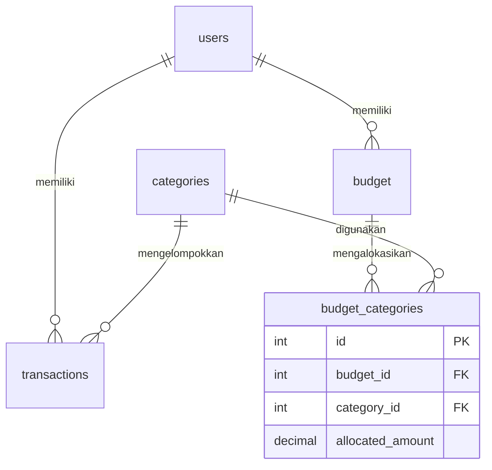

# Rancangan Asisten Keuangan

## Domain dan masalah

Service mengelola pengguna, kategori, transaksi pengeluaran, dan alokasi Budget bulanan. Pengguna dibantu melihat pengeluaran per kategori/user serta membandingkan pengeluaran dengan alokasi. Category digunakan bersama; Budget dimiliki satu User dan dapat memakai banyak Category melalui pivot berisi allocated_amount.

Dua consumer: aplikasi web pribadi untuk mencatat pengeluaran dan memantau sisa Budget; aplikasi mobile untuk memasukkan transaksi harian serta melihat perkiraan nilai dalam mata uang lain. Keduanya memanggil kontrak REST yang sama.

Service menyimpan data dan relasi lokal, memvalidasi referensi/periode, menerapkan aturan bisnis, dan menghitung ringkasan Budget. API kurs hanya menyediakan kurs, sehingga tidak dapat menggantikan pencatatan pengeluaran, relasi pengguna, dan alokasi anggaran milik aplikasi.

## ERD

UNIQUE(user_id, month, year) membatasi periode Budget; UNIQUE(budget_id, category_id) membatasi pivot. Semua lima tabel memiliki model Sequelize terpisah yang didaftarkan di src/models/index.js. User menggunakan paranoid:true. Category memiliki setter nama dan virtual formatted_name. Model User/Category/Budget mempunyai validate.

## Aturan bisnis

1. Kategori yang masih dipakai Transactions atau alokasi Budget tidak boleh dihapus: 409, melalui pengecekan transaksi dan FK RESTRICT.
2. Budget user/bulan/tahun yang sudah ada tidak boleh dibuat lagi atau ditimpa lewat perpindahan periode: 409.
3. Alokasi Budget wajib lebih dari nol, maksimal dua desimal: 400.
4. Kategori tidak boleh berulang dalam satu Budget: 400.
5. Email User yang sudah terdaftar tidak boleh digunakan lagi: 409. Soft-deleted User tetap mempertahankan batas unik email.
6. PUT wajib lengkap, PATCH tidak boleh kosong, dan field asing ditolak: 400.

## Arsitektur dan validasi

routes hanya memasang method/path dan middleware. Controller mengelola alur, model mengelola tabel/relasi. index.js menyusun aplikasi. Input POST/PUT/PATCH memakai Joi dengan abortEarly:false; errors memuat field dan pesan Indonesia. Hanya hasil validasi yang disimpan. Password baru di-hash scrypt dan dikeluarkan dari respons.

Create memakai 201 + Location; data hilang 404; method salah 405 + Allow; konflik 409; input invalid 400. Error tidak memuat SQL, stack trace, atau kredensial. Koneksi DB gagal menghasilkan 503.

## ORM dan raw query

GET /api/v1/transactions default memakai ORM (mode=orm): findAll/include dengan Op.like, Op.gte, Op.lte, sort, limit, offset. ORM dipakai sebagai jalur utama untuk menjaga konsistensi relasi/model. mode=raw menyediakan versi pembanding melalui sequelize.query dengan replacements. Nilai filter/pagination memakai parameter. Arah sort hanya menerima asc/desc; keyword ini dipilih dari daftar terbatas, bukan nilai bebas.

Kedua versi mengembalikan kontrak yang sama. Raw memberi kendali SQL namun membutuhkan pemeliharaan JOIN/soft delete secara eksplisit. Ini dua implementasi operasi baca, bukan dua kali penulisan transaksi.

GET daftar/detail Budget memakai include Category dan through.attributes allocated_amount. Alias kategori pada JSON adalah categories; data pivot ada di Budget_categories. GET daftar Budget memakai satu SELECT JOIN. Summary Budget memakai dua query tetap (include dan agregasi) dan tidak melakukan query per kategori.

## Rancangan akses — belum diimplementasikan

JWT tidak diwajibkan soal dan belum diterapkan. Endpoint aktual tetap dapat dipanggil tanpa autentikasi. Matriks di bawah adalah rancangan, bukan perilaku runtime.

| Resource/path | Admin | Pengguna terautentikasi | Tamu |
|---|---|---|---|
| /users | GET semua, POST | Tidak | POST registrasi saja |
| /users/:id | GET/PUT/PATCH/DELETE semua | Akun sendiri | Tidak |
| /users/:id/transactions | GET semua | Data sendiri | Tidak |
| /users/:id/budgets | GET semua | Data sendiri | Tidak |
| /users/:id/subscription-status | GET semua | Data sendiri | Tidak |
| /categories dan /categories/:id | Semua method terdaftar | GET | Tidak |
| /categories/:id/transactions | GET semua | GET transaksi sendiri | Tidak |
| /transactions dan /transactions/:id | Semua method terdaftar | CRUD transaksi sendiri | Tidak |
| /transactions/:id/conversion | GET semua | GET transaksi sendiri | Tidak |
| /budgets dan /budgets/:id | Semua method terdaftar | CRUD Budget sendiri | Tidak |
| /budgets/:id/summary | GET semua | GET Budget sendiri | Tidak |

Admin menjaga data kategori dan integritas pengelolaan. Pengguna dilindungi melalui pembatasan kepemilikan data; implementasi selanjutnya wajib mengambil identitas dari sesi terverifikasi, bukan body. Tamu hanya diberi registrasi dalam rancangan agar data keuangan tidak terbuka.

Kredensial disimpan pada .env yang diabaikan Git; .env.example hanya placeholder. Saat dipasang di cloud, gunakan environment secret/secret manager, pisahkan development/production, batasi hak akun database, rotasi key, dan hindari memasukkan rahasia ke log atau image deployment. Pemeriksaan historis seluruh commit tidak termasuk paket ini.

## Integrasi API

Endpoint /transactions/:id/conversion menggabungkan transaksi dari DB dan kurs dari ExchangeRate-API melalui Axios. Field provider dipilih dan diganti nama menjadi base_currency, target_currency, rate, updated_at; estimated_amount merupakan estimasi tampilan. Key berada pada EXCHANGE_RATE_API_KEY.

Endpoint /users/:id/subscription-status menggabungkan profil DB dengan status pembayaran order yang dipetakan per user pada MIDTRANS_ORDER_IDS. UserController menangani HTTP/profil, sedangkan src/services/midtrans.js menangani konfigurasi, autentikasi provider, lookup status, pencocokan order_id/transaction_id, dan pemilihan field. MIDTRANS_ENVIRONMENT memilih sandbox/production. Tidak ada order global tetap atau fallback key dummy; order duplikat antaruser ditolak. Pemetaan environment merupakan konfigurasi operator untuk prototipe, belum berupa tabel pembayaran atau bukti kepemilikan otomatis. Endpoint tidak membuat pembayaran atau mengaktifkan langganan.

Timeout menghasilkan 504; network/non-2xx atau payload invalid umumnya 502; konfigurasi provider/order belum tersedia 503. Khusus Midtrans, order yang tidak ditemukan menghasilkan 404 dan autentikasi provider ditolak menghasilkan 502; error di JSON pada HTTP 200 juga diperiksa. Tidak ada fallback kurs atau status pembayaran palsu. Axios menggunakan timeout, AbortSignal, batas ukuran respons, dan tanpa redirect.

## Pengujian

24 tes otomatis lulus dengan database simulasi, termasuk rollback, metode baru, isolasi nested User, agregasi periode/kategori, validasi, dan error API. Koleksi 52 request/128 assertion lulus melalui Newman dengan database simulasi. Dua integrasi provider pada koleksi default menguji kondisi belum dikonfigurasi (503); jalur sukses provider pada tes kode menggunakan adapter simulasi. Request Midtrans pada jalur HTTP 200 lulus 5 assertion dengan provider simulasi. .env unggahan belum berisi key/pemetaan Midtrans. Belum ada klaim keberhasilan MySQL atau provider asli. Rincian ada di PEMERIKSAAN-MIDTRANS.md.

## Bukti SQL aktual

Jalankan node scripts/bukti-budget-join.js pada MySQL aktif dengan Budget dan kategori tersedia. Skrip memasukkan SQL aktual ke bagian berpenanda otomatis di bawah setelah berhasil. Tanpa bagian tersebut, bukti aktual belum direkam. Log tes simulasi tidak digunakan sebagai bukti.

## Daftar endpoint

| No | Method | Path | Fungsi | Sukses | Gagal |
|---|---|---|---|---|---|
| 1 | GET | `/api/v1/users` | Daftar user aktif; pencarian, sort, pagination | 200 | 400, 404, 405, 503, 500 |
| 2 | POST | `/api/v1/users` | Buat user | 201 | 400, 404, 405, 409, 503, 500 |
| 3 | GET | `/api/v1/users/:id/transactions` | Transaksi milik user | 200 | 400, 404, 405, 503, 500 |
| 4 | GET | `/api/v1/users/:id/budgets` | Budget milik user | 200 | 400, 404, 405, 503, 500 |
| 5 | GET | `/api/v1/users/:id/subscription-status` | Status pembayaran Midtrans untuk order user | 200 | 400, 404, 405, 502, 503, 504, 500 |
| 6 | GET | `/api/v1/users/:id` | Detail user | 200 | 400, 404, 405, 503, 500 |
| 7 | PUT | `/api/v1/users/:id` | Ganti lengkap user | 200 | 400, 404, 405, 409, 503, 500 |
| 8 | PATCH | `/api/v1/users/:id` | Ubah sebagian user | 200 | 400, 404, 405, 409, 503, 500 |
| 9 | DELETE | `/api/v1/users/:id` | Soft delete user | 200 | 400, 404, 405, 409, 503, 500 |
| 10 | GET | `/api/v1/categories` | Daftar kategori | 200 | 400, 404, 405, 503, 500 |
| 11 | POST | `/api/v1/categories` | Buat kategori | 201 | 400, 404, 405, 409, 503, 500 |
| 12 | GET | `/api/v1/categories/:id` | Detail kategori | 200 | 400, 404, 405, 503, 500 |
| 13 | PUT | `/api/v1/categories/:id` | Ganti nama dan ikon kategori | 200 | 400, 404, 405, 409, 503, 500 |
| 14 | PATCH | `/api/v1/categories/:id` | Ubah sebagian kategori | 200 | 400, 404, 405, 409, 503, 500 |
| 15 | DELETE | `/api/v1/categories/:id` | Hapus kategori jika tidak dipakai | 204 | 400, 404, 405, 409, 503, 500 |
| 16 | GET | `/api/v1/transactions` | Daftar transaksi ORM/raw; filter, sort, pagination | 200 | 400, 404, 405, 503, 500 |
| 17 | POST | `/api/v1/transactions` | Buat transaksi | 201 | 400, 404, 405, 409, 503, 500 |
| 18 | GET | `/api/v1/transactions/:id/conversion` | Gabungkan transaksi dan kurs API | 200 | 400, 404, 405, 502, 503, 504, 500 |
| 19 | GET | `/api/v1/categories/:id/transactions` | Transaksi kategori | 200 | 400, 404, 405, 503, 500 |
| 20 | GET | `/api/v1/transactions/:id` | Detail transaksi dan relasi | 200 | 400, 404, 405, 503, 500 |
| 21 | PUT | `/api/v1/transactions/:id` | Ganti lengkap transaksi | 200 | 400, 404, 405, 409, 503, 500 |
| 22 | PATCH | `/api/v1/transactions/:id` | Ubah nominal/catatan | 200 | 400, 404, 405, 409, 503, 500 |
| 23 | DELETE | `/api/v1/transactions/:id` | Hapus transaksi | 200 | 400, 404, 405, 409, 503, 500 |
| 24 | GET | `/api/v1/budgets` | Daftar Budget dengan kategori/pivot | 200 | 400, 404, 405, 503, 500 |
| 25 | POST | `/api/v1/budgets` | Buat Budget dan alokasi | 201 | 400, 404, 405, 409, 503, 500 |
| 26 | GET | `/api/v1/budgets/:id/summary` | Ringkasan alokasi, pengeluaran, dan sisa | 200 | 400, 404, 405, 503, 500 |
| 27 | GET | `/api/v1/budgets/:id` | Detail Budget dan pivot | 200 | 400, 404, 405, 503, 500 |
| 28 | PUT | `/api/v1/budgets/:id` | Ganti lengkap Budget dan alokasi | 200 | 400, 404, 405, 409, 503, 500 |
| 29 | PATCH | `/api/v1/budgets/:id` | Ubah periode atau daftar alokasi | 200 | 400, 404, 405, 409, 503, 500 |
| 30 | DELETE | `/api/v1/budgets/:id` | Hapus Budget dan pivot | 204 | 400, 404, 405, 409, 503, 500 |

//2

