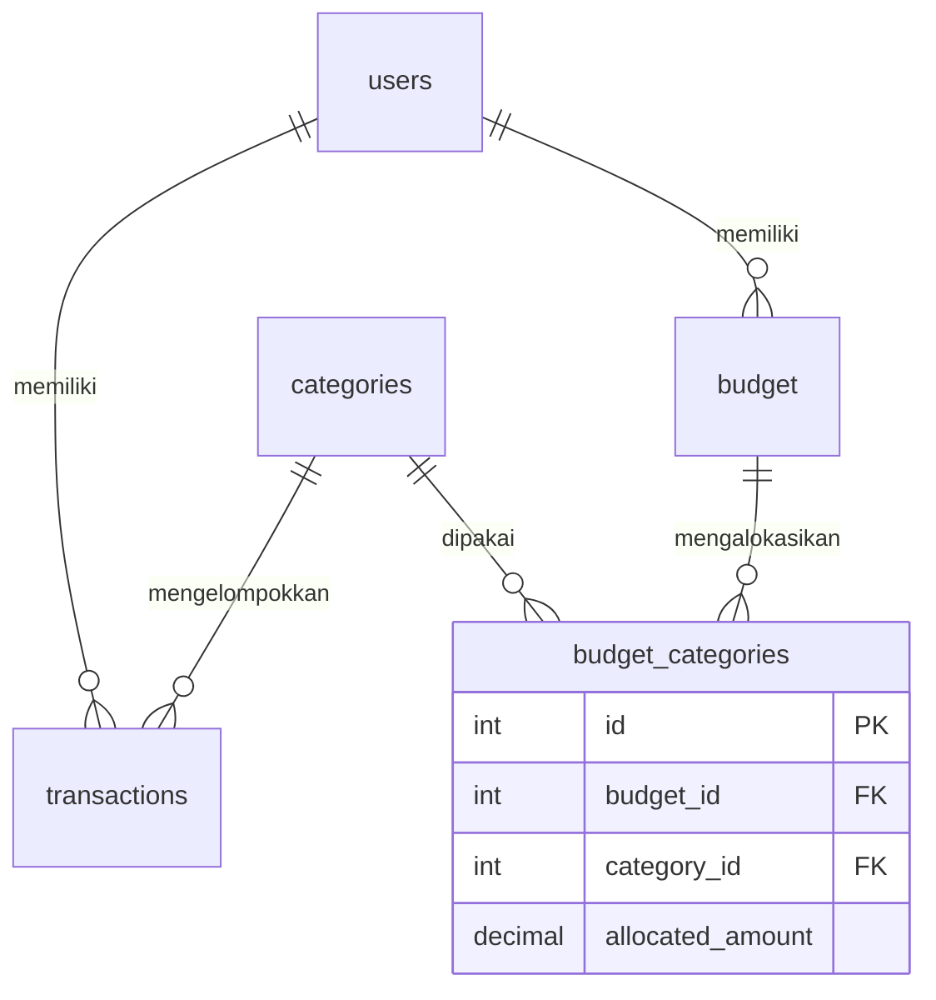
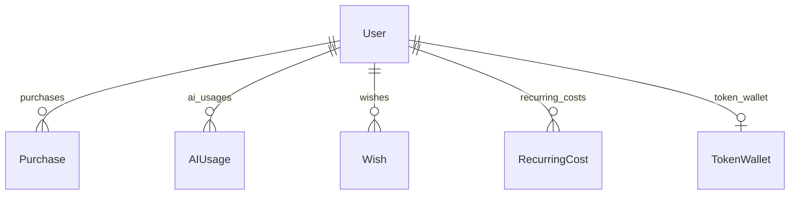

# Rancangan ProjectSOA — kontrak M1

Status: **draft kontrak bersama v0.1**, siap ditinjau Kenneth, Bryan, Dana, Rafael. Tidak menyatakan empat anggota sudah menyetujui.
Sumber awal adalah arsip Service-Oriented-Architecture.zip, disalin sebagai ProjectSOA.
Fokus M1 adalah baseline, relasi, kontrak API, pembagian PIC dan satu acuan UI. Tidak menambah pembayaran, AI, autentikasi, scheduler, atau migrasi bisnis baru.

## 1. Yang sudah berjalan dan yang baru dirancang

Existing: 30 endpoint, 5 model, CRUD User/Category/pengeluaran/Budget, N:M Budget–Category, summary, konversi kurs, serta pembacaan status order Midtrans.
Belum ada: login/JWT, pembelian paket token, wallet/ledger, pemanggilan AI, pemasukan, wish/cicilan, recurring, PDF dan koneksi bank.
Adapter Midtrans existing hanya membaca status order dari pemetaan environment. Ini belum menjadi sistem pembelian atau bukti saldo token.

| Fitur rencana | Aturan awal | PIC utama |
|---|---|---|
| Pemasukan | Model Income terpisah; nominal positif, sumber, tanggal; tidak mengubah transaksi lama menjadi pemasukan | Dana |
| Paket token | TokenPackage berisi jumlah token integer, harga IDR, status aktif dan versi; harga katalog final belum ditentukan | Bryan |
| Pembelian | Purchase menyimpan snapshot harga/token paket; pemilik dan nominal berasal dari server | Bryan |
| Wallet / ledger | Satu wallet per user; ledger append-only untuk kredit, debit dan koreksi; saldo tidak diedit dari client | Kenneth |
| AI usage | Simpan input/output token aktual provider, model, status dan referensi debit; bukan panjang karakter | Dana |
| Tips gratis | Rekomendasi berbasis aturan tanpa debit wallet; jika memakai AI nanti, biaya tidak diam-diam dibebankan ke user | Dana |
| Wish / cicilan | Target cash atau rencana cicilan pribadi; bukan pengajuan kredit atau layanan pemberian pinjaman | Rafael |
| Recurring | Jadwal aktif/jeda, biaya dapat diedit untuk periode berikutnya; histori yang sudah terbentuk tetap | Dana |
| Laporan | Ringkasan pemasukan/pengeluaran dan PDF sesuai pemilik serta periode yang sama | Rafael |
| Bank bersyarat | Hanya jika akses API resmi, sandbox, izin pengguna dan lingkup akses tersedia; jika belum, tetap off dan gunakan pencatatan manual | Rafael |

## 2. Relasi existing wajib dipertahankan

`Budget.belongsToMany(Category, { through: BudgetCategory })` dan relasi balik tetap.
BudgetCategory tetap memakai file `src/models/Budget_categories.js`, tabel `budget_categories`, alias ekspor `BudgetCategory` dan alias legacy `Budget_categories`.
UNIQUE(budget_id, category_id) serta UNIQUE(user_id, month, year) tetap. Alokasi uang berada pada pivot, bukan kolom Category.

## 3. Calon relasi baru — belum menjadi model runtime

User.hasMany(Purchase/AIUsage/Wish/RecurringCost) dan pasangan belongsTo memakai FK baru `user_id`.
User.hasOne(TokenWallet), TokenWallet.belongsTo(User), UNIQUE(token_wallets.user_id).
Wallet boleh belum ada untuk user lama; dibuat sekali secara transaksional saat fitur diaktifkan. UI menampilkan belum tersedia sampai backfill selesai, bukan mengarang saldo.

| Model calon / tabel | Field awal penting | Relasi / batas unik |
|---|---|---|
| Income / incomes | id, user_id, amount, source, occurred_on, note | User hasMany Income |
| TokenPackage / token_packages | id, name, token_amount, price_idr, version, is_active | hasMany Purchase; snapshot wajib |
| Purchase / purchases | id, user_id, token_package_id, order_id, amount, currency, token_amount, status, idempotency_key | UNIQUE(order_id), UNIQUE(user_id,idempotency_key) |
| TokenWallet / token_wallets | id, user_id, balance_tokens, reserved_tokens | UNIQUE(user_id); saldo tersedia = balance-reserved |
| TokenLedger / token_ledgers | id, user_id, token_wallet_id, delta_tokens, balance_after, reference_type, reference_id, event_key | UNIQUE(event_key); append-only |
| AIUsage / ai_usages | id, user_id, model, input_tokens, output_tokens, charged_tokens, status, idempotency_key, provider_usage | UNIQUE(user_id,idempotency_key); referensi debit ledger unik |
| Wish / wishes | id, user_id, name, target_amount, method, target_date, status | method cash/installment |
| WishInstallment / wish_installments | id, wish_id, sequence, due_on, amount, transaction_id, status | UNIQUE(wish_id,sequence); pembayaran tercatat sekali |
| RecurringCost / recurring_costs | id, user_id, category_id, amount, interval_unit, interval_count, next_due_on, status | belongsTo Category |
| RecurringOccurrence / recurring_occurrences | id, recurring_cost_id, due_on, transaction_id | UNIQUE(recurring_cost_id,due_on) |

PK resource baru direncanakan INT UNSIGNED. FK ke `users.id` harus INT signed seperti tabel existing.
Jumlah token memakai integer, tanpa pecahan. Ledger boleh mempunyai delta negatif; balance dan reserved tidak negatif, dan reserved tidak boleh melebihi balance. FK histori uang/token ke User memakai RESTRICT, bukan cascade penghapusan ledger.
Pilihan BIGINT untuk token harus tetap membatasi JSON integer pada Number.MAX_SAFE_INTEGER; angka di luar batas ditolak, tidak dibulatkan.

## 4. Aturan bisnis yang mengikat rancangan

1. Pembelian pending belum menambah saldo. Callback verified dan status pembayaran sah mengkredit wallet sekali dalam transaksi yang sama dengan ledger dan status Purchase. Redirect browser tidak membuktikan pembayaran.
2. Request checkout memakai Idempotency-Key per user. Replay mengembalikan Purchase yang sama; payload berbeda pada key sama menghasilkan 409.
3. AI memakai reservasi saldo, lalu debit usage aktual dan pelepasan sisa. Kegagalan sebelum tagihan melepas reservasi; hasil provider yang belum pasti masuk rekonsiliasi, bukan langsung mengulang debit. Semua perubahan saldo melalui satu service wallet milik Kenneth.
4. Kontrak tarif awal untuk disetujui: charged_tokens = input_tokens + output_tokens, 1 kredit internal per token provider. Pemetaan usage/model disimpan dengan versi. Input panjang tidak menjamin output panjang; keduanya dihitung terpisah dari usage provider.
5. Cash pada Wish baru menjadi pengeluaran setelah realisasi dikonfirmasi. Cicilan adalah rencana: payload memakai term_months integer; input tahun pada UI diubah eksplisit menjadi jumlah bulan; angsuran terakhir menyerap selisih pembulatan dua desimal. Bunga/biaya tambahan belum disepakati dan tidak boleh diasumsikan.
6. Recurring menghasilkan satu occurrence per tanggal jatuh tempo. Edit biaya tidak mengubah histori. Saat merealisasikan recurring/cicilan, tautkan ke satu Transaction untuk mencegah pengeluaran ganda.
7. Income tetap terpisah dari pengeluaran existing. Laporan saldo uang = pemasukan - pengeluaran, sedangkan saldo token adalah satuan layanan AI yang berbeda.
8. Semua sumber milik user diperiksa di server berdasarkan JWT terverifikasi. Resource milik orang lain tidak boleh terbaca hanya karena ID-nya diketahui.

## 5. Data, migrasi dan kompatibilitas

- Prefix API tetap `/api/v1`. Kontrak terperinci ada di [KONTRAK_API.md](docs/KONTRAK_API.md).
- Uang baru: DECIMAL(15,2), currency IDR, JSON berupa string desimal dua angka. DECIMAL(10,2) pada alokasi lama dipertahankan sampai ada migrasi perluasan tersendiri.
- Nama kolom lama tidak diganti: `id_user` pada transactions dan `user_id` pada budget tetap. DTO baru memakai `user_id` yang diisi server.
- Tanggal bisnis baru: YYYY-MM-DD dalam Asia/Jakarta. Timestamp API: ISO 8601 UTC. Backfill tanggal transaksi lama menunggu audit zona waktu DB, tidak ditebak.
- Migrasi berikutnya harus additive, bernomor dan dicatat sekali. Tambah tabel/kolom nullable, backfill terukur, baru constraint. Tidak memakai DROP/TRUNCATE/reset seed/sync(force:true).
- `scripts/migrate.js` existing adalah bootstrap CREATE IF NOT EXISTS, belum runner migrasi berversi dan belum mengubah tabel lama. Runner upgrade dan backup/restore uji adalah pekerjaan Kenneth.
- Data lama tidak mendapat saldo token hadiah tanpa keputusan tim; baseline M1 tidak menjalankan SQL apa pun ke DB pengguna.

## 6. Satu acuan UI dan perubahan kontrak

[KONTRAK_UI.md](docs/KONTRAK_UI.md), [wireframe](frontend/wireframes.html), dan [tokens.css](frontend/src/styles/tokens.css) adalah sumber bersama.
Setiap usulan perubahan field/relasi/response/UI shell masuk dokumen ini dan kontrak terkait dalam PR yang sama. PIC menulis alasan, dampak endpoint/Postman/migrasi/UI, reviewer menyetujui sebelum merge.
Endpoint existing dan planned dibedakan; nama endpoint rencana tidak berarti endpoint sudah aktif.

## 7. Tinjauan tim yang masih diperlukan

| Anggota | Bagian yang diperiksa | Status |
|---|---|---|
| Kenneth | ERD, N:M, migrasi, wallet, tokens UI | Belum ditinjau |
| Bryan | Auth, pembelian, ownership, login/register | Belum ditinjau |
| Dana | Income, AI usage, recurring, formulir | Belum ditinjau |
| Rafael | 30 endpoint, laporan/wish, UI dashboard, regression | Belum ditinjau |

Harga katalog, provider/model AI, biaya cicilan, serta akses bank belum final. Rancangan boleh dirinci pada milestone berikutnya; keputusan yang mengubah kontrak tidak dibuat diam-diam oleh satu anggota.
Referensi teknis: [Sequelize M:N](https://sequelize.org/docs/v6/advanced-association-concepts/advanced-many-to-many/) dan [Midtrans notification](https://docs.midtrans.com/docs/https-notification-webhooks). Tidak ada integrasi baru pada M1.
